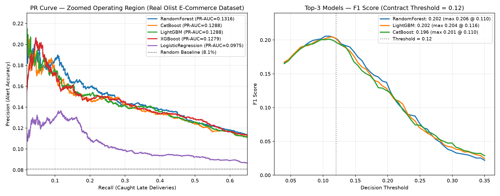

# 01: Delivery SLA Breach Predictor (Python LightGBM -> ONNX -> Go)

A sub-millisecond, zero-skew Classic ML inference service that predicts whether an e-commerce order will breach its delivery SLA at checkout time. Models are trained and benchmarked in Python (`uv`), exported to ONNX, and served via an idiomatic Go HTTP API with compile-time schema contracts and cross-language parity tests.

## 1. Background & Domain Context

This module is modeled directly after real operational problems from my time in **Tokopedia's Fulfillment and Logistics tribes**, where I worked on the core delivery module (*Orchestra*) handling multi-segment SLA tracking (`Pickup -> First Mile -> Middle Mile -> Last Mile`), 3PL partner reconciliation, and multi-hop routing across carriers (AnterAja, JNE, SiCepat).

In archipelago e-commerce logistics, delivery delays are expensive in asymmetric ways:

* **False Negative (Missed Late Delivery):** The order silently breaches its promised SLA, leading to buyer complaints, refund vouchers, support tickets, or customer churn.
* **False Positive (Early Alert on an On-Time Order):** The system flags a risky shipment at checkout, triggering a cheap automated intervention such as routing to a higher-SLA 3PL partner, adjusting the checkout ETA buffer, or sending a proactive delay notice.

In production, this prediction must run synchronously inside the checkout or fulfillment dispatch path on standard CPU infrastructure. That imposes strict requirements: **sub-millisecond p99 latency, predictable cost at high QPS, deterministic handling of missing fields, and zero drift between offline Python training and live Go serving.**

## 2. Why Classic ML (Not an LLM or Neural Network)

All checkout-time signals (`distance_km`, `weight_grams`, `seller_late_rate`, `is_weekend`, `freight_ratio`) live in structured relational tables.

* **Why not an LLM:** Calling an LLM API for tabular risk scoring adds 1 to 3 seconds of latency, costs orders of magnitude more per 1M orders, is non-deterministic, and is difficult to audit or calibrate against a probability threshold.
* **Why not an MLP (Neural Network):** Logistics rules are full of sharp thresholds (for example, long distance combined with a historically slow seller). Decision trees split on exact cutoffs natively and accept unscaled features and `NaN`s straight from SQL. An MLP requires extra `SimpleImputer` and `StandardScaler` preprocessing bundled into the serving artifact, takes longer to tune, and rarely beats gradient boosted trees on structured tables of this size.
* **Why GBDTs + ONNX in Go:** A compact tree ensemble exported to ONNX runs locally in microseconds on a cheap CPU container, handles missing values natively, and lets ops teams tune a single probability threshold against real business costs.

## 3. Dataset & Feature Engineering

### Real-World Data: Olist Brazilian E-Commerce
Models are trained on the public [Olist Brazilian E-Commerce Dataset](https://www.kaggle.com/datasets/olistbr/brazilian-ecommerce), fetched automatically via `kagglehub` (with local `ml/data/` override and a synthetic generator fallback for offline CI).

* **Target Definition:** `is_late = 1` when `order_delivered_customer_date > order_estimated_delivery_date`, filtered strictly to delivered orders with valid timestamps.
* **Dataset Scale:** **95,992** real delivered orders split 80/20 with stratification (**76,793 train / 19,199 test**).
* **Class Imbalance:** **8.10%** base late delivery rate. Because 91.9% of orders arrive on time, raw accuracy is a trap (a dummy classifier predicting "on time" scores 91.9% accuracy while catching zero breaches). Evaluation therefore focuses on **PR-AUC**, **Precision**, **Recall**, and **F1**.

### Feature Contract (`feature_contract.json`)
Relational tables (`orders`, `order_items`, `products`, `customers`, `sellers`, `geolocation`) are aggregated to one row per order and mapped to five strictly typed features:

| Feature | Type | Nullable | Derivation |
| :--- | :--- | :---: | :--- |
| `distance_km` | `float32` | No | Haversine distance between seller and customer zip-code centroids |
| `weight_grams` | `float32` | Yes (`NaN`) | Sum of product weights across order items |
| `seller_late_rate` | `float32` | Yes (`NaN`) | Historical late delivery rate for the seller (min 5 training orders) |
| `is_weekend` | `float32` | No | `1.0` if `order_purchase_timestamp` falls on Saturday or Sunday, else `0.0` |
| `freight_ratio` | `float32` | No | `total_freight / (total_price + total_freight + 1e-6)` |

### Preventing Data Leakage
`seller_late_rate` is a target-encoded feature. Computing it across the full dataset before splitting would leak future test outcomes into training. In `ml/train.py` and `01_eda_benchmark.ipynb`, `seller_late_rate` is computed **strictly on `train_df`** (requiring at least 5 historical orders per seller) and then mapped onto `test_df`. Unseen or low-volume sellers remain `NaN`, testing the pipeline's native missing-value path end to end.

## 4. Model Benchmark & Engineering Trade-Offs

Five models were benchmarked on the exact same 76,793 / 19,199 Olist split using the contract decision threshold (`0.12`):

| Model | PR-AUC | Precision (@0.12) | Recall (@0.12) | F1 (@0.12) | Peak F1 (@th) |
| :--- | :---: | :---: | :---: | :---: | :---: |
| Random Forest | **0.1316** | **0.1414** | 0.3537 | **0.2021** | 0.2083 (@0.105) |
| **LightGBM (Exported to ONNX)** | 0.1288 | 0.1402 | **0.3614** | 0.2020 | 0.2048 (@0.118) |
| XGBoost | 0.1279 | 0.1381 | 0.3550 | 0.1988 | 0.2057 (@0.104) |
| CatBoost | 0.1288 | 0.1380 | 0.3402 | 0.1964 | 0.2034 (@0.106) |
| Logistic Regression (Baseline) | 0.0975 | 0.1364 | 0.1164 | 0.1256 | 0.1574 (@0.084) |



### Key Takeaways from the Benchmark

1. **Tree Ensembles Beat the Linear Baseline by ~60% in F1:** All four tree models cluster tightly around `PR-AUC = 0.128 - 0.132` (`F1 = 0.196 - 0.202`), catching roughly 3x more late deliveries than Logistic Regression (`Recall = 0.3614` vs. `0.1164`).
2. **Why Export LightGBM Over Random Forest:** Random Forest edges out LightGBM by `0.0028` PR-AUC (`0.0001` F1 at `0.12`), which is within statistical noise on a 5-feature noisy dataset where bagging dampens variance well. LightGBM is exported to production for systems trade-offs:
   * **Smaller Artifact & Faster CPU Inference:** 120 compact leaf-wise trees (`num_leaves=31`) vs. 150 deep trees (`max_depth=12`, up to 4,096 leaves each), giving lower RAM usage and better CPU cache locality.
   * **Higher Recall at the Contract Threshold:** `0.3614` vs. `0.3537`, catching more late deliveries at `0.12`.
   * **Clean Native `NaN` ONNX Parity:** LightGBM learns optimal default branches for `NaN` natively and converts cleanly via `onnxmltools`.
3. **Why Contract Threshold = `0.12`:**
   * LightGBM's F1 curve forms a flat plateau across `0.11 - 0.12` (peaking at `0.118`). Picking `0.12` avoids overfitting to the third decimal place of `X_test`.
   * Pushing the threshold up to the Precision-Recall crossover (`~0.16`) only gains ~2 points of precision while cutting recall roughly in half, which is a bad trade-off when missed SLA penalties outweigh cheap reroute alerts.

## 5. Zero-Skew Architecture (`train.py` <-> `main.go`)

A common failure mode in polyglot ML systems (Python training + Go serving) is **Training-Serving Skew**: column order silently drifts between a Python DataFrame and a Go `[]float32` slice, or Go's JSON unmarshaler silently turns a missing (`null`) numeric field into `0.0`.

This module prevents skew with a four-layer contract pipeline:

```text
feature_contract.json (Single Source of Truth: ordered features, types, nullability, threshold)
 ├── ml/train.py       -> enforces exact column order, exports artifacts/model.onnx (zipmap=False)
 │                        and artifacts/golden_fixtures.json (100 real test rows + expected probs)
 └── go generate       -> reads feature_contract.json, computes SHA-256 SchemaHash, generates
      │                   go/internal/contract/features_gen.go (PredictRequest + ToFloat32Slice)
      └── go test      -> runs 100 golden JSON payloads through Go ONNX Runtime
                          verifies SchemaHash match and asserts |go_prob - py_prob| < 1e-5
```

### Safeguards Built Into the Pipeline
* **Zero Hand-Indexed Slices:** `main.go` never writes `vec[2] = ...`. It decodes JSON into the code-generated `contract.PredictRequest` struct and calls `req.ToFloat32Slice()`.
* **Explicit `null` vs. `0.0` Separation:** Nullable features generate `*float32` pointer fields in Go. A JSON `null` (or omitted field) maps explicitly to `float32(math.NaN())` instead of `0.0`.
* **SHA-256 Schema Drift Gate:** Both `train.py` and `go/internal/contract/gen.go` hash the canonical feature list (`schema_hash = fe66b8873d6c`). If someone changes `feature_contract.json` and forgets to regenerate Go code or retrain the model, `TestPythonGoParity` fails immediately.
* **Non-Cached Parity Test:** `make test` runs `GOWORK=off go test -count=1 -v ./...` so Go never serves a cached test pass after `model.onnx` or `golden_fixtures.json` changes. All **100/100 real Olist cases pass within `1e-5` in ~0.06s**.

## 6. Training & Export Process

Running `make train MOD=01-delivery-sla-breach` executes `ml/train.py`:

1. Loads `feature_contract.json` and computes the canonical 12-char SHA-256 `schema_hash`.
2. Loads Olist CSVs from `ml/data/` or `kagglehub` (falling back to synthetic data if offline), runs the stratified 80/20 split, and computes leak-free `seller_late_rate` on `train_df`.
3. Trains all 5 models (`LogisticRegression`, `RandomForest`, `CatBoost`, `XGBoost`, `LightGBM`) and prints a sorted leaderboard with PR-AUC, contract-threshold Precision/Recall/F1, and exact Peak F1 (@threshold).
4. Converts the trained LightGBM model to ONNX (`target_opset=15`, `zipmap=False`) so Go receives a flat `[N, 2]` `float32` probability tensor at `artifacts/model.onnx`.
5. Runs the first 100 held-out test rows (preserving `null`s) through Python `onnxruntime` and writes `artifacts/golden_fixtures.json`.

For visual EDA, PR-AUC curves, Top-3 F1 threshold sweeps, and the operational cost simulator (`$2` FP vs. `$15` FN), run `ml/notebooks/01_eda_benchmark.ipynb`.

## 7. Go HTTP Inference API

`go/cmd/server/main.go` serves `artifacts/model.onnx` over HTTP with:
* Structured JSON logging via `log/slog`
* Strict ingress validation (`http.MaxBytesReader` + `dec.DisallowUnknownFields()` so typoed field names fail with `400 Bad Request` instead of silently defaulting to `0`)
* Per-request inference latency reported in microseconds (`latency_us`)
* Graceful shutdown on `SIGINT` / `SIGTERM`

### Environment Variables

| Variable | Default | Description |
| :--- | :--- | :--- |
| `PORT` | `8081` | HTTP listen port |
| `MODEL_PATH` | `../artifacts/model.onnx` | Path to exported ONNX model |
| `ONNXRUNTIME_LIB` | *(auto-resolved by Makefile)* | Path to `libonnxruntime.so` / `.dylib` |

### Endpoints

#### `GET /healthz`
Returns service health and the active compiled contract version and hash.

```bash
curl -s http://localhost:8081/healthz
```

```json
{
  "schema_hash": "fe66b8873d6c",
  "schema_version": "v1.0.0",
  "status": "ok"
}
```

#### `POST /predict`
Scores a single checkout order and returns the SLA breach probability and decision. Nullable fields (`weight_grams`, `seller_late_rate`) accept `null`.

```bash
curl -s -X POST http://localhost:8081/predict \
  -H "Content-Type: application/json" \
  -d '{
    "distance_km": 920.5,
    "weight_grams": null,
    "seller_late_rate": 0.32,
    "is_weekend": 1,
    "freight_ratio": 0.45
  }'
```

```json
{
  "is_late": true,
  "probability": 0.218432,
  "threshold": 0.12,
  "schema_version": "v1.0.0",
  "schema_hash": "fe66b8873d6c",
  "latency_us": 184
}
```

## 8. Directory Layout & Quickstart

```text
01-delivery-sla-breach/
├── README.md
├── feature_contract.json           # Single source of truth (Python <-> Go)
├── artifacts/
│   ├── model.onnx                  # Exported LightGBM model
│   ├── golden_fixtures.json        # 100 real Olist test payloads for parity checks
│   └── pr_curve_threshold.png      # Zoomed PR-AUC & Top-3 F1 chart
├── ml/                             # Isolated Python 3.12 env (uv)
│   ├── pyproject.toml
│   ├── uv.lock
│   ├── train.py
│   └── notebooks/
│       └── 01_eda_benchmark.ipynb
└── go/                             # Isolated Go module
    ├── go.mod
    ├── parity_test.go              # 100-case Python <-> Go parity test
    ├── cmd/server/main.go          # Production HTTP server
    └── internal/contract/
        ├── doc.go                  # //go:generate trigger
        ├── gen.go                  # Contract-to-Go code generator
        └── features_gen.go         # Generated PredictRequest & SchemaHash
```

### Run Everything from the Repository Root

```bash
# 1. Train all 5 models on Olist & export model.onnx + golden_fixtures.json
make train MOD=01-delivery-sla-breach

# 2. Regenerate Go contract structs & SHA-256 schema hash
make gen MOD=01-delivery-sla-breach

# 3. Verify 1:1 Python <-> Go parity (non-cached, 100/100 real orders)
make test MOD=01-delivery-sla-breach

# 4. Re-execute the EDA & benchmark notebook (regenerates pr_curve_threshold.png)
cd 01-delivery-sla-breach/ml && uv run jupyter nbconvert --to notebook --execute --inplace notebooks/01_eda_benchmark.ipynb && cd ../..

# 5. Start the Go HTTP inference server on :8081
make serve MOD=01-delivery-sla-breach
```

## 9. Signal Ceiling & v2 Roadmap

The tight clustering of all four tree models (`PR-AUC = 0.128 - 0.132`) demonstrates a core practical ML lesson: **once you are on a solid GBDT, better features beat swapping algorithms.** Five checkout-time features cannot observe carrier strikes, weather, or regional hub congestion.

Future `v2.0.0` contract additions (requiring only a `feature_contract.json` update + `make train && make gen && make test`):
* **`estimated_days`:** Promised SLA window (`order_estimated_delivery_date - order_purchase_timestamp`), since tight promises breach far more often than padded ones.
* **`is_cross_state`:** Boolean flag for interstate transfers (`seller_state != customer_state`), capturing Brazil's interstate logistics and tax-checkpoint bottlenecks.
* **`volume_cm3`:** Volumetric parcel size (`length * height * width`), since bulky packages get bumped off last-mile vehicles.
* **Probability Calibration:** Platt scaling or isotonic calibration on a dedicated validation split if downstream systems consume raw probabilities for expected-value routing calculations.
