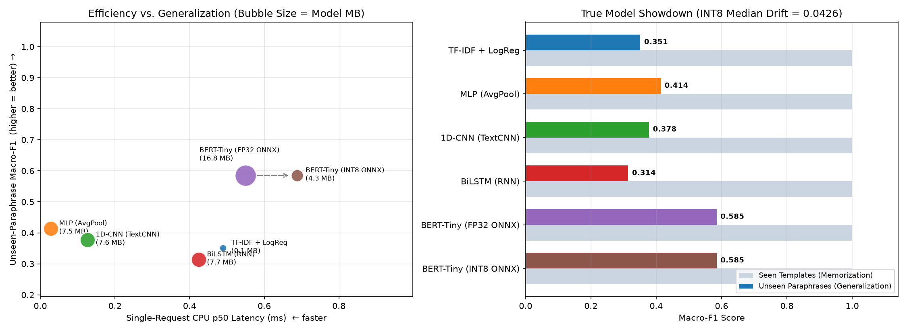

# 03 — Neural Networks to Transformers (PyTorch -> FP32/INT8 ONNX -> Go WordPiece)

Production-grade Encoder Transformer inference service in Go featuring a **zero-dependency Go WordPiece tokenizer**, **FP32 vs. dynamic INT8 ONNX** serving, and a **100/100 Python-to-Go parity gate**.

---

## 1. Problem Statement & Module Boundary

In **Module 02 (`02-classic-nlp`)**, TF-IDF + linear models handled straightforward keyword-heavy routing cheaply and reliably. However, real customer support tickets frequently contain:
* **Negation & cross-domain distractors:** *"I did not ask for a billing refund, I just want to know why my shipment is delayed."*
* **Unseen paraphrases & synonyms:** Users say *"voucher"*, *"credit me back"*, or *"doorstep"* even when training data only contained *"promo"*, *"refund"*, and *"address"*.

This module stays strictly on **1D text/sequence modeling** (leaving 2D images, audio waveforms, and video frames to Module 04) and proves empirically *when* it is worth upgrading from Classic NLP to a pre-trained Encoder Transformer—and how to serve that Transformer in Go without Python in the hot path.

---

## 2. Architecture Showdown: Mental Models

All five model families were benchmarked on the exact same 4-class support ticket task (`billing_refund`, `delivery_delay`, `account_access`, `technical_bug`):

| Architecture | How It Reads Text | Strengths | Production Trade-Off |
| :--- | :--- | :--- | :--- |
| **TF-IDF + LogReg** | Bag-of-words exact keyword counts (1–2 grams) | Tiny (`0.15 MB`), instant training, interpretable | Blind to word order, negation, and unseen synonyms (weight = `0.0`) |
| **MLP (AvgPool)** | Averages token embeddings across the whole sentence | Fastest neural CPU inference (`0.03 ms`) | Still order-blind; collapses when trained from scratch on small datasets |
| **1D-CNN (TextCNN)** | Slides parallel 3/4/5-token n-gram filters across text | Captures local phrases in parallel (`0.13 ms` CPU) | Struggles with long-range negation across clauses; no pre-trained vocabulary |
| **BiLSTM (RNN)** | Reads tokens sequentially left-to-right and right-to-left | Models word order and sequential state | Sequential bottleneck makes CPU inference **3x–14x slower** than CNN/MLP at similar size (`7.71 MB`) |
| **Encoder Transformer (`bert-tiny`)** | Multi-head **Self-Attention** attends to every token pair in parallel | Pre-trained on millions of sentences; transfers English semantics to unseen phrasing | Heavier FP32 footprint (`16.81 MB`) and $O(N^2)$ attention cost, mitigated by short `max_seq_len=64` and INT8 quantization |

---

## 3. Architecture Decision Record (ADR)

### Decision 1: Why `prajjwal1/bert-tiny` (4.4M params) instead of DistilBERT (66M)?
* **GitHub-safe artifacts:** Exports to **`16.81 MB` (FP32)** and **`4.31 MB` (INT8)**, keeping the repository lightweight (versus ~260 MB for FP32 DistilBERT).
* **Full Transformer mechanics on CPU:** Still uses genuine multi-head Self-Attention, positional embeddings, LayerNorm, and standard BERT WordPiece (`vocab.txt`), while fine-tuning in under 30 seconds on CPU.

### Decision 2: Why Test on Unseen Paraphrases (Template Split) Instead of a Random Split?
* On a naive random split, **all six models scored `1.0000` Macro-F1** by memorizing training phrasing—giving zero objective reason to ship a Transformer over a `0.15 MB` TF-IDF model.
* Splitting by **held-out unseen templates** (`1,120 train` / `280 seen-val` / `400 unseen-test`) exposed the real production gap: from-scratch baselines collapsed to **`0.3141–0.4137` Macro-F1**, while pre-trained `bert-tiny` reached **`0.5848` Macro-F1** (+17 to +27 F1 points) via transfer learning and Self-Attention.
* *(Note: Initializing MLP/1D-CNN/BiLSTM with pre-trained static embeddings like GloVe/FastText narrows this gap on small datasets, though static vectors still lack context-aware disambiguation.)*

### Decision 3: Why a Zero-Dependency Go WordPiece Tokenizer?
* Calling HuggingFace's Rust `tokenizers` via CGO adds cross-compilation complexity and extra shared-library management.
* Implementing BERT's `BasicTokenizer` + greedy longest-match-first `WordPiece` directly in Go (`internal/tokenizer/wordpiece.go`, ~115 LOC) reads the exact `vocab.txt` exported by Python, requires **zero third-party Go packages**, and is gated by a **100/100 token-ID parity test** against HuggingFace `BertTokenizer`.

### Decision 4: Why Export and Benchmark Both FP32 and Dynamic INT8 ONNX?
* Dynamic `QUInt8` quantization (`onnxruntime.quantization.quantize_dynamic`) shrank the model **3.9x** (`16.81 MB` → `4.31 MB`) with **100/100 label agreement** and a median max-logit drift of **`0.0426`** (p95/max: `0.2542`).
* **Critical Systems Lesson:** Never assume INT8 is automatically faster on CPU. At `bert-tiny`'s narrow hidden width (`128`) and `batch_size=1`, runtime quantize/dequantize overhead slightly outweighs MatMul savings (`0.830 ms` INT8 vs. `0.727 ms` FP32 in Go). INT8 wins on **memory/disk footprint** here, whereas INT8 latency speedups typically appear on wider models (e.g., 768-dim BERT-base/DistilBERT) or batched requests.

---

## 4. Zero-Skew Architecture (`train.py` <-> `main.go`)

```text
feature_contract.json (model_id, max_seq_len=64, do_lower_case, vocab_file, labels)
 ├── ml/train.py     -> benchmarks 5 architectures, fine-tunes BERT-Tiny, exports:
 │                      artifacts/model_fp32.onnx, model_int8.onnx, vocab.txt & 100 golden_fixtures.json
 └── go generate     -> generates internal/contract/contract_gen.go + SHA-256 SchemaHash (8f761a46c23e)
      └── go test    -> enforces 3 CI parity gates against Python before release
```

**The 3 CI Parity Gates (`go/parity_test.go`):**
1. **SchemaHash Gate:** Fails immediately if `feature_contract.json` changed in Python without regenerating Go constants (`make gen`).
2. **WordPiece Tokenization Gate:** Asserts 100/100 exact element-by-element equality of `input_ids` and `attention_mask` between Go `tokenizer.WordPiece` and Python `BertTokenizer`.
3. **ONNX Logits Gate:** Asserts 100/100 logit parity within `1e-4` (FP32) and `1e-3` (INT8) plus 100% predicted-label agreement.

---

## 5. Benchmark Results (CPU)

| Model | Seen F1 | Unseen F1 | Python CPU p50 (ms) | Go ONNX Avg (ms) | Artifact Size (MB) |
| :--- | :---: | :---: | :---: | :---: | :---: |
| TF-IDF + LogReg | 1.0000 | 0.3512 | 0.49 | — | 0.15 |
| MLP (AvgPool) | 1.0000 | 0.4137 | 0.03 | — | 7.47 |
| 1D-CNN (TextCNN) | 1.0000 | 0.3778 | 0.13 | — | 7.60 |
| BiLSTM (RNN) | 1.0000 | 0.3141 | 0.42 | — | 7.71 |
| **BERT-Tiny (FP32 ONNX)** | **1.0000** | **0.5848** | **0.55** | **0.727** | **16.81** |
| **BERT-Tiny (INT8 ONNX)** | **1.0000** | **0.5848** | **0.69** | **0.830** | **4.31** |

* **CI Parity Gate:** `TestTransformerParity` — **100/100 PASS** in `0.27s` (`schema_hash=8f761a46c23e`).
* **Live HTTP End-to-End Latency:** `POST /predict` (JSON decode + Go WordPiece + INT8 ONNX + Softmax) completes in **`~2.04 ms`** (`2036 us`).



---

## 6. Quickstart & API Usage

From the repository root:

```bash
# 1. Train baselines + BERT-Tiny, export FP32/INT8 ONNX, vocab.txt & golden_fixtures.json
make train MOD=03-transformer-onnx

# 2. Generate Go contract constants + SHA-256 SchemaHash
make gen MOD=03-transformer-onnx

# 3. Run 100/100 WordPiece + FP32 + INT8 parity gate
make test MOD=03-transformer-onnx

# 4. Serve live HTTP API (loads both INT8 and FP32 sessions at startup)
make serve MOD=03-transformer-onnx
```

**Endpoints:**
* `GET /healthz` — returns `status`, `model_id`, `schema_version`, and `schema_hash`.
* `POST /predict` — accepts `{"text": "...", "precision": "int8" | "fp32"}` (defaults to `"int8"`).

**Example Request & Response:**
```bash
curl -s -X POST http://localhost:8083/predict \
  -H "Content-Type: application/json" \
  -d '{"text": "I did not ask for a billing refund, I just want to know why my shipment is delayed", "precision": "int8"}' | jq
```

```json
{
  "label": "delivery_delay",
  "confidence": 0.9766427,
  "probabilities": {
    "account_access": 0.0087358905,
    "billing_refund": 0.010568982,
    "delivery_delay": 0.9766427,
    "technical_bug": 0.0040524187
  },
  "precision": "int8",
  "schema_version": "v1.0.0",
  "schema_hash": "8f761a46c23e",
  "latency_us": 2036
}
```
