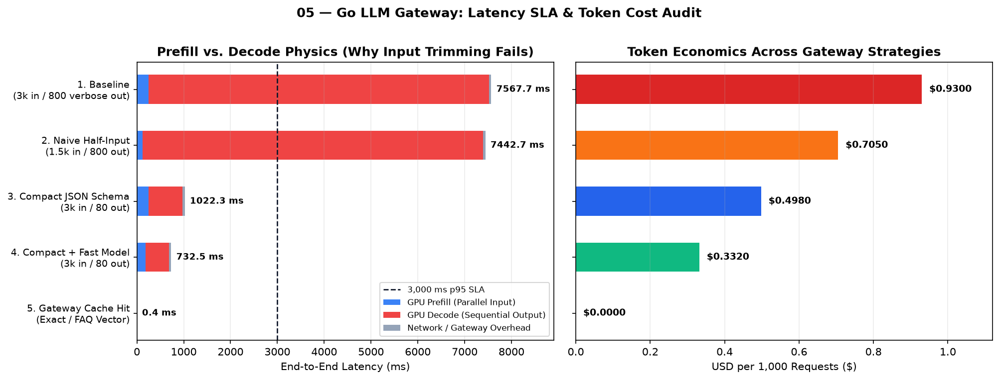

# 05 — Go LLM Gateway: Streaming SSE, Entity-Safe Caching, Multi-Cloud Failover & Cost Ledger

Pure-Go, zero-CGO **Multi-Tenant LLM Control Plane** featuring real-time **SSE streaming with `r.Context()` cancellation**, **PII/Entity-gated two-tier caching**, **cross-cloud wire translation & failover** (OpenAI/Groq Bearer API -> Native Google Gemini `generateContent` `x-goog-api-key` API), **bounded structured JSON repair**, and **defer-safe USD token accounting**—locked to `feature_contract.json` (`schema_hash=6b0739238375`).



---

## 1. Architectural Shift: Owning the Control Plane

In Modules `01`–`04`, compact ONNX weights ran inside the Go binary (`0.02–5 ms` on CPU). Frontier LLMs (`20B–1T+` parameters) live on remote GPU/LPU clusters where requests take **hundreds of milliseconds to seconds**, cost **metered dollars per million tokens**, and fail with `429` rate limits, wire-protocol quirks, truncated JSON, or abandoned mobile streams. This gateway turns untrusted upstream LLM APIs into governed backend infrastructure:

```text
feature_contract.json (Pricing $/1M in/out, RPM & USD caps, retryable HTTP codes, PII/ID patterns)
 ├── ml/train.py       -> models Prefill vs Decode latency + exports 10 golden guardrail fixtures
 └── go generate       -> emits internal/contract/contract_gen.go + SHA-256 SchemaHash (6b0739238375)

POST /v1/chat/completions  |  POST /v1/extract/refund
 ├── internal/ledger   -> Per-tenant Token-Bucket RPM + Daily USD Budget Gate (429 / 402)
 ├── internal/guard    -> <0.1ms Regex/Digit Scanner (Order IDs, Email, Phone, NIK/Card, Currency)
 ├── internal/cache    -> Exact SHA-256 (temp <= 0.1) + Entity-Gated Semantic Cache (cosine >= 0.75)
 └── internal/provider -> Unified Client Interface:
      ├── Primary      -> OpenAI / Groq LPU / NVIDIA NIM (/v1/chat/completions Bearer SSE)
      ├── Secondary    -> Native Google Gemini Adapter (:generateContent via x-goog-api-key)
      ├── Sync JSON    -> finish_reason check + strict struct decode + 1 bounded repair retry
      └── Stream SSE   -> http.NewRequestWithContext(r.Context()) + typed event:error + defer ledger
```

---

## 2. Key Architecture Decisions (ADR)

### Decision 1: Attacking Output Decode (Why Trimming Input Prompts Misses p95 SLAs)
GPU **Prefill** processes all input tokens in parallel (`12,000–16,000 tok/s`), whereas **Decode** generates output tokens sequentially one-by-one (`110–160 tok/s`). On a 3,000-token policy prompt with an 800-token verbose output (`7,567.7 ms`):
* Halving the input prompt to 1,500 tokens only saves **`125 ms`** (`7,442.7 ms`—still blowing past a `3,000 ms` SLA).
* Replacing prose with an **80-token structured JSON schema** cuts total latency **7.4x** (`1,022.3 ms`), and routing to a faster tier brings cache-miss latency down to **`732.5 ms`** (`$0.332` / 1k reqs).

### Decision 2: Entity/PII Guardrail Before Semantic Vector Caching (The Fintech Trap)
Vector caches work well on paraphrased helpdesk FAQs (*"How do I reset my security PIN?"* <-> *"Please tell me how to reset my security PIN"*), returning in `< 1 ms` at `$0.00`. However, `"Check refund eligibility for Order #10042"` and `"Check refund eligibility for Order #10049"` share `>0.89` similarity—meaning a naive semantic cache returns **another customer's refund decision**.
* `internal/guard` runs a deterministic microsecond scan first: any prompt containing order/ticket IDs, currency amounts, phone numbers, emails, or 12–19 digit IDs sets `entity_sensitive=true` and **bypasses semantic vector lookup**, permitting only tenant-scoped exact SHA-256 hits at `temperature <= 0.1`.

### Decision 3: Cross-Cloud Protocol Translation (`OpenAIHTTPClient` + `GeminiNativeClient`)
Relying solely on OpenAI-compatible shims breaks when upstream auth rules diverge (for example, Google `AQ.*` keys rejecting `Authorization: Bearer` on `/v1beta/openai` with `401 ACCESS_TOKEN_TYPE_UNSUPPORTED`). Implementing a clean `provider.Client` interface allows Primary traffic to stream over OpenAI/Groq Bearer SSE while seamlessly failing over on `429`/`5xx` to Google's native `:generateContent` REST protocol using `x-goog-api-key`.

### Decision 4: SSE Context Cancellation, Post-200 Error Framing & `defer` Accounting
* **Stop Paying for Dead Tabs:** Upstream requests bind directly to `r.Context()` (`http.NewRequestWithContext`). When a client disconnects mid-stream, Go closes the upstream TCP socket immediately, halting GPU generation.
* **Post-200 Mid-Stream Failures:** Once `HTTP 200 OK` (`text/event-stream`) headers flush on token #1, HTTP status codes cannot revert to `502`. Mid-stream upstream failures emit a typed `event: error` SSE frame (`{"code":"upstream_stream_interrupted","retryable":true}`).
* **Zero Unbilled Streams:** Token usage (`stream_options.include_usage` on completion, chunk count fallback on abort) is recorded inside a `defer` block so canceled streams never escape the tenant ledger.

---

## 3. Benchmarks & Live Multi-Cloud Verification

### Modeled Policy-Prompt Benchmark (`ml/train.py`)

| Strategy (3,000-Token Policy Scenario) | Prefill | Decode | Total Latency | Cost / 1k Reqs |
| :--- | :---: | :---: | :---: | :---: |
| **1. Baseline (`3k` in / `800` verbose out)** | `250.0 ms` | `7,272.7 ms` | `7,567.7 ms` | `$0.9300` |
| **2. Naive Half-Input (`1.5k` in / `800` out)** | `125.0 ms` | `7,272.7 ms` | `7,442.7 ms` | `$0.7050` |
| **3. Compact JSON Schema (`3k` in / `80` out)** | `250.0 ms` | `727.3 ms` | **`1,022.3 ms`** | `$0.4980` |
| **4. Compact + Fast Model (`gemini-2.5-flash`)** | `187.5 ms` | `500.0 ms` | **`732.5 ms`** | `$0.3320` |
| **5. Gateway Cache Hit (Exact / Entity-Free FAQ)** | `0.0 ms` | `0.0 ms` | **`0.4 ms`** | **`$0.0000`** |

### Live Multi-Cloud Smoke Measurements (Groq Primary + Google Gemini Native Fallback)

| Live Request Path | Upstream Provider & Model | Measured Latency | Cost (USD) | Gateway Outcome |
| :--- | :--- | :---: | :---: | :--- |
| `POST /v1/chat/completions` (`stream=true`) | Groq (`openai/gpt-oss-20b`) | Real-time SSE | Metered via `defer` | Token deltas flushed to `[DONE]` |
| `POST /v1/chat/completions` (Primary `429`) | Google Native (`gemini-3.8-flash`) | `5,574.6 ms` | `$0.0000114` | Automatic cross-cloud failover (`failed_over: true`) |
| `POST /v1/chat/completions` (Retry Hit) | `gateway_cache` (`exact_sha256`) | **`0.064 ms` (`64 µs`)** | **`$0.0000000`** | **87,102x faster**, zero upstream tokens |
| `POST /v1/extract/refund` (Strict JSON) | Groq (`openai/gpt-oss-20b`) | **`842.4 ms`** | `$0.0001185` | Schema + domain invariant verified (`attempts: 1`) |

### Deterministic CI Test Suite (`make test MOD=05-llm-gateway`)
Runs 100% offline with zero API keys required (`6.13s`):
* `TestGoldenParityAndEntityGuard` — **PASS** (`10/10` Python <-> Go entity/PII parity + `schema_hash=6b0739238375`).
* `TestSemanticCacheHitVsOrderIDTrapPrevention` — **PASS** (FAQ paraphrase hits `semantic_vector` at `$0`; `Order #10042` vs `#10049` blocked from colliding).
* `TestFailoverAndStructuredJSONRepair` — **PASS** (Primary `429` -> automatic fallback; malformed JSON repaired on attempt `2`).
* `TestSSEContextCancellationAndMidstreamError` — **PASS** (Client `context.Cancel` halts upstream stream + logs partial spend; mid-stream cut emits `event: error`; exhausted budget returns `402 Payment Required`).

---

## 4. Quickstart & Live Provider Configuration

Runs out of the box with embedded mock upstreams, or automatically switches to live cloud upstreams when `GROQ_API_KEY`, `OPENAI_API_KEY`, `NVIDIA_API_KEY`, or `GOOGLE_API_KEY` are exported:

```bash
make train MOD=05-llm-gateway
make gen   MOD=05-llm-gateway
make test  MOD=05-llm-gateway
make serve MOD=05-llm-gateway
```

### Live Smoke Commands

```bash
# 1. Stream SSE tokens in real time
curl -N -X POST http://localhost:8085/v1/chat/completions \
  -H "Content-Type: application/json" \
  -d '{"tenant_id":"live","stream":true,"messages":[{"role":"user","content":"Give 3 short bullet points on why Go is ideal for an LLM gateway."}]}'

# 2. Trigger Primary 429 -> Native Gemini Failover
curl -s -X POST http://localhost:8085/v1/chat/completions \
  -H "Content-Type: application/json" \
  -d '{"tenant_id":"live","fault_inject":"force_live_failover","messages":[{"role":"user","content":"Confirm which model answered after failover in one sentence."}]}' | jq

# 3. Structured refund extraction with domain invariant check
curl -s -X POST http://localhost:8085/v1/extract/refund \
  -H "Content-Type: application/json" \
  -d '{"tenant_id":"live","ticket_text":"Customer received cracked item on Order #10042, paid Rp 150000, unboxing video verified.","max_refundable_idr":200000}' | jq

# 4. Inspect per-tenant token & USD spend ledger
curl -s "http://localhost:8085/v1/ledger?tenant_id=live" | jq
```
